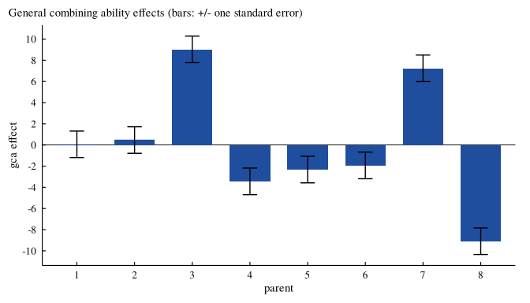

# DiallelAnalysisR: Diallel Analysis, Heterosis and Related Mating

Designs

[](https://CRAN.R-project.org/package=DiallelAnalysisR)
[](https://CRAN.R-project.org/package=DiallelAnalysisR)
[](https://github.com/myaseen208/DiallelAnalysisR/actions/workflows/R-CMD-check.yml)

## Overview

**DiallelAnalysisR** analyses diallel crosses of plant-breeding
experiments laid out in randomized complete blocks:

- [`Griffing()`](https://myaseen208.com/DiallelAnalysisR/reference/Griffing.md):
  Griffing’s (1956) Methods 1 to 4 with fixed or random effects: the
  analysis of variance of general and specific combining ability and
  reciprocal effects, the effects with their standard errors, and the
  variance components;
- [`Hayman()`](https://myaseen208.com/DiallelAnalysisR/reference/Hayman.md):
  Hayman’s (1954) analysis of variance, the Wr-Vr analysis and graph,
  the components of variation D, H1, H2, F, h2 and E, genetic ratios and
  tests of the additive-dominance model;
- [`PartialDiallel()`](https://myaseen208.com/DiallelAnalysisR/reference/PartialDiallel.md):
  crosses between two groups of parents: combining ability of each group
  and of the crosses;
- [`GriffingMeans()`](https://myaseen208.com/DiallelAnalysisR/reference/GriffingMeans.md):
  Griffing’s analysis of a published table of cross means, with the
  error from the paper;
- [`Heterosis()`](https://myaseen208.com/DiallelAnalysisR/reference/Heterosis.md):
  mid-parent, better-parent and standard heterosis with t tests;
- `Griffing(..., Reciprocal = "split")`: Cockerham and Weir’s maternal
  and non-maternal reciprocal effects;
- [`GardnerEberhart()`](https://myaseen208.com/DiallelAnalysisR/reference/GardnerEberhart.md):
  Gardner and Eberhart’s (1966) Analyses II and III;
- [`LineTester()`](https://myaseen208.com/DiallelAnalysisR/reference/LineTester.md)
  and
  [`NCDesign()`](https://myaseen208.com/DiallelAnalysisR/reference/NCDesign.md):
  line by tester analysis with proportional contributions, and North
  Carolina designs I, II and III;
- [`GriffingEnv()`](https://myaseen208.com/DiallelAnalysisR/reference/GriffingEnv.md):
  a diallel over several environments, with gca by environment and sca
  by environment;
- `plot(fit, which = "biplot")`: a biplot of the cross means showing the
  best combiners and crosses;
- [`DiallelSim()`](https://myaseen208.com/DiallelAnalysisR/reference/DiallelSim.md)
  and
  [`DiallelPower()`](https://myaseen208.com/DiallelAnalysisR/reference/DiallelPower.md):
  simulated diallels for teaching and power for planning the replicates;
- [`da_export()`](https://myaseen208.com/DiallelAnalysisR/reference/da_export.md):
  the main tables in Word, LaTeX, HTML, Markdown or CSV for papers;
- [`DiallelApp()`](https://myaseen208.com/DiallelAnalysisR/reference/DiallelApp.md):
  all of the above in a web browser, without code.

The package has been on CRAN since 2016 (version 0.1.1, 2016-04-09).
Version 1.0.0 keeps every function name, argument and result component
of earlier versions, so existing scripts run unchanged. It corrects the
standard errors of Griffing’s analysis and several results of
[`Hayman()`](https://myaseen208.com/DiallelAnalysisR/reference/Hayman.md)
and
[`PartialDiallel()`](https://myaseen208.com/DiallelAnalysisR/reference/PartialDiallel.md)
(see NEWS), adds plots and methods to every result, the analyses above,
complete help pages with the formulas, fifteen vignettes in HTML and
PDF, a comparison with the published values of Griffing (1956), and is
many times faster for larger diallels.

## Installation

``` r

install.packages("DiallelAnalysisR")
# development version
# install.packages("remotes")
remotes::install_github("myaseen208/DiallelAnalysisR")
```

## Quick start

``` r

library(DiallelAnalysisR)
fit <-
  Griffing(
      y          = Yield
    , Rep        = Rep
    , Cross1     = Cross1
    , Cross2     = Cross2
    , data       = GriffingData1
    , Method     = 1
    , Model      = 1
    , Reciprocal = c("combined", "split")[1]
    )
fit$ANOVA
```

``` R
             Df  Sum Sq Mean Sq F value Pr(>F)    
gca           7  3804.6  543.52 18.8868 <2e-16 ***
sca          28 22060.8  787.89 27.3783 <2e-16 ***
reciprocals  28   365.5   13.05  0.4536 0.9923    
Error       189  5439.0   28.78                   
---
Signif. codes:  0 '***' 0.001 '**' 0.01 '*' 0.05 '.' 0.1 ' ' 1
```

``` r

round(x = fit$GCA, digits = 2)
```

``` R
    1     2     3     4     5     6     7     8 
 0.06  0.47  9.03 -3.44 -2.33 -1.93  7.24 -9.10 
```

``` r

plot(fit)
```



## Learn more

- Vignettes: `browseVignettes("DiallelAnalysisR")`, starting with
  `DiallelAnalysisR_01_getting_started`; each is available as HTML and
  as PDF.
- Site: <https://myaseen208.com/DiallelAnalysisR/>
- Notation:
  [`da_notation()`](https://myaseen208.com/DiallelAnalysisR/reference/da_notation.md)
- Shiny application:
  [`DiallelApp()`](https://myaseen208.com/DiallelAnalysisR/reference/DiallelApp.md)

## Citation

``` R
Yaseen M, Eskridge K, Barbosa P, Guo Y (2026). _DiallelAnalysisR:
Diallel Analysis, Heterosis and Related Mating Designs_. R package
version 1.0.0 (first released 2016),
<https://CRAN.R-project.org/package=DiallelAnalysisR>.
```

BibTeX:

``` R
@Manual{DiallelAnalysisR,
  title = {{DiallelAnalysisR}: Diallel Analysis, Heterosis and Related Mating Designs},
  author = {Muhammad Yaseen and Kent Eskridge and Pedro Barbosa and Yuhang Guo},
  year = {2026},
  note = {R package version 1.0.0 (first released 2016)},
  url = {https://CRAN.R-project.org/package=DiallelAnalysisR},
}
```
